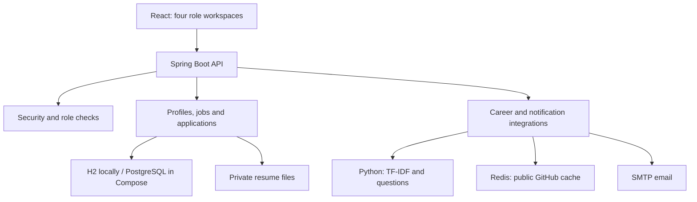

# SkillSetu

A student career, recruitment and university placement platform with a React frontend, Spring Boot API and optional Python career service.

**Start with [START_HERE.md](START_HERE.md)** for the Windows setup and four demo accounts. This repository provides a complete local v1 of the main workflows. The distributed microservices architecture from the long-term idea is a later evolution.

## What works

| Area | Implemented behavior |
| --- | --- |
| Authentication | Student/recruiter registration, BCrypt passwords, signed JWTs, four roles, ownership checks, login attempt limiting, session revocation on logout/password change/disable |
| Student profile | Skills, academic details, projects, education, experience and recruiter discovery preference |
| Resumes | Private PDF/DOCX/TXT uploads, text extraction, dictionary skill detection, version history and authorized downloads |
| Opportunities | Public and campus openings, search/type/work-mode filters, saved jobs, eligibility and explainable compatibility scores |
| Recommendations | Skill, CGPA, experience and location scoring; optional TF-IDF text ranking from Python |
| Applications | Duplicate prevention, submitted resume version capture, cover notes, status timeline and withdrawal |
| Recruitment | Company profile, job creation/editing/status, candidate search, invitations and controlled pipeline transitions |
| Interviews | Date/time, meeting link, instructions, duration, recruiter/student conflict checks, completion/cancellation |
| Preparation | Missing-skill paths, five-question text mocks, answer feedback, practice history; optional generated questions |
| Coding profiles | Public GitHub statistics with optional Redis cache; self-declared GitHub and LeetCode profile links |
| Notifications | In-app updates polled every 20 seconds; optional SMTP email |
| Placement | University-scoped batch analytics, department/year filters, distinct hired student counts, CSV export and announcements |
| Administration | Staff provisioning, account enabling/disabling, universities, selected audit events and system configuration summary |
| Operations | Persistent local database, PostgreSQL configuration, health endpoint, Docker Compose files, automated backend/Python checks and CI workflow |

## Project layout

```text
backend/        Spring API, persistence, security and integration tests
frontend/       React screens for all four roles
ai-service/     Optional FastAPI TF-IDF ranking and question generation
docs/           API guide, integrations and verification record
compose.yaml    Local Docker stack with PostgreSQL and Redis
start-dev.ps1   Windows development launcher
START_HERE.md   First-run instructions
```

## Local development

Requirements: JDK 17+, Node.js 24 LTS. Python 3.12 is optional.

Windows backend:

```powershell
cd backend
.\mvnw.cmd spring-boot:run
```

Frontend in another terminal:

```powershell
cd frontend
npm.cmd ci
npm.cmd run dev
```

macOS/Linux: use `sh mvnw spring-boot:run` from `backend`, and `npm ci` / `npm run dev` from `frontend`.

Visit **http://localhost:5173**. Vite proxies `/api` to port 8081. Default H2 data and resumes persist inside `backend/data`.

## Docker option

With Docker Engine/Desktop and Compose installed, from the root:

```sh
docker compose up --build
```

Visit **http://localhost:5173** after startup. Compose runs PostgreSQL, Redis, Python, Spring and nginx. Database/resume volumes preserve data. `docker compose down` stops the stack without deleting those volumes. The included configuration is a local demo with demo credentials, bound to the local computer.

Docker execution was not available in the build environment; the Docker configuration is supplied but is not claimed as runtime-tested. The database driver/configuration is included; the automated backend checks use H2 in PostgreSQL mode rather than a live PostgreSQL instance.

## Automated checks

```powershell
cd backend
.\mvnw.cmd verify
```

```powershell
cd frontend
npm.cmd ci
npm.cmd run build
```

Python checks after installing dependencies:

```powershell
cd ai-service
python -m pip install -r requirements.txt httpx==0.28.1
python -m unittest discover -v
```

The GitHub Actions workflow runs these checks on pushes and pull requests. You need to push this folder into your own repository for that workflow to run there.

## Architecture



There is one Spring application, organized by responsibility, plus an optional Python service. This keeps transactions and deployment manageable while you build the product.

## Matching and AI behavior

The base match uses **70% required skills, 15% academic fit, 10% experience and 5% location/work mode**. Academic and experience minimums are also eligibility checks. The UI explains missing skills and component scores. A score describes profile compatibility, not a hiring probability.

When Python is configured, recommendation ordering uses 75% base match and 25% TF-IDF cosine text similarity. This is lexical ranking, not a trained prediction model or semantic embeddings. The displayed base compatibility score remains explainable.

Interview feedback uses keyword coverage and answer length. It is a practice aid, not a validated interview assessment. With no provider credentials, questions come from a built-in bank. Optional provider calls generate questions only; scoring remains local. Engine labels expose the chosen mode and fallback.

## Current boundaries and next extensions

- Google/GitHub OAuth sign-in is not implemented. JWT login and the OAuth2 resource-server library validate bearer tokens; they do not provide third-party sign-in.
- Resume parsing reads existing text; scanned/image-only PDFs need OCR, which is not included.
- GitHub/LeetCode usernames and university membership are self-declared. LeetCode automatic problem-count sync is not included.
- Notifications poll; WebSocket/SSE delivery is a future upgrade. SMTP delivery is best effort, without durable retries or an outbox.
- Files use private local storage; S3/cloud object storage, malware scanning and upload encryption at rest are future work.
- Microservice splitting, API gateway, Kafka/RabbitMQ, video/voice interviews and trained ML models are future extensions.
- This is a portfolio/local v1. Before a public launch, add reviewed schema migrations, deployment secrets, HTTPS, verified campus enrollment, durable email delivery, monitoring, load testing, backups and production access review. The default schema mode is `update` for local development.

Do not describe these extensions as implemented on your resume. The working four-role platform is already a substantial project.

See [docs/API.md](docs/API.md), [docs/INTEGRATIONS.md](docs/INTEGRATIONS.md) and [docs/VERIFICATION.md](docs/VERIFICATION.md) for reference after your first run.
