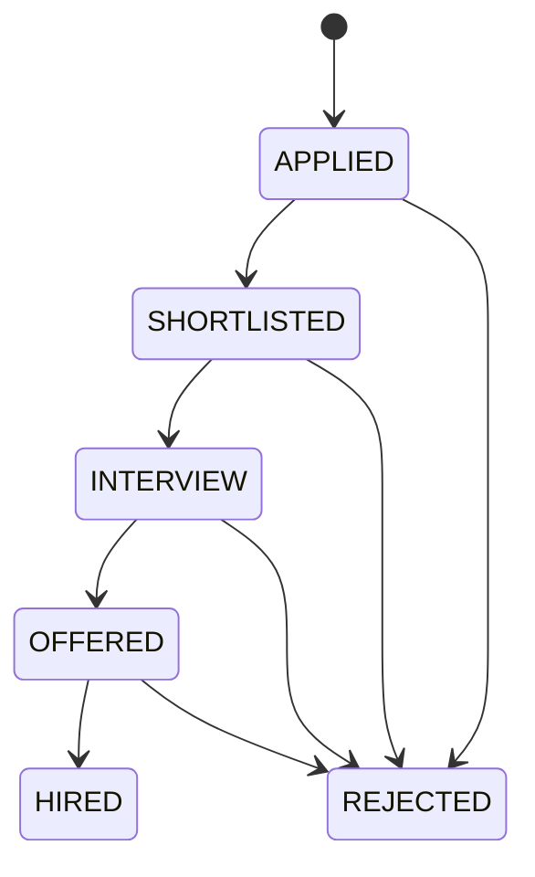

# API guide

Base URL in development: `http://localhost:8081/api`. JSON requests use `Content-Type: application/json`. Protected requests use `Authorization: Bearer <token>`.

Login example:

```json
{"email":"student@skillsetu.dev","password":"Demo@12345"}
```

Send it to `POST /auth/login`. The response contains `token` and `user`; password hashes are excluded. Error responses from application validation contain a `message`. Security-filter failures can have empty bodies; clients should use the HTTP status.

| Access | Methods and paths | Purpose |
| --- | --- | --- |
| Public | GET `/public/info`, `/public/universities`, `/public/jobs`, `/public/jobs/{id}` | Public platform data; campus-only jobs excluded |
| Public | POST `/auth/register`, `/auth/login` | Student/recruiter signup and login |
| Signed in | GET `/auth/me`; POST `/auth/logout`; PATCH `/account` | Current user, revoke sessions, rename/change password |
| Signed in | GET `/dashboard`, `/jobs`, `/jobs/{id}` | Role dashboard and accessible openings |
| Student | GET/PUT `/student/profile` | Profile and aggregate profile view |
| Student | POST `/student/projects`, `/student/education`, `/student/experience`; DELETE respective `/{id}` | Profile entries |
| Student | GET `/student/recommendations`, `/student/learning` | Ranked openings and skill gaps |
| Student | GET `/student/saved`; POST/DELETE `/student/saved/{jobId}` | Saved jobs |
| Student | GET/POST `/student/applications`; POST `/student/applications/{id}/withdraw` | Apply and track |
| Student | GET/POST `/student/resumes`; DELETE `/student/resumes/{id}` | Resume versions; POST uses multipart field `file` |
| Owner/authorized recruiter/admin | GET `/resumes/{id}/download` | Private resume download |
| Student | POST `/student/coding/sync` | Public GitHub statistics |
| Student | GET/POST `/student/practice`; POST `/student/practice/{id}/submit` | Text mock sessions |
| Recruiter | GET/PUT `/recruiter/company` | Company profile |
| Recruiter | GET/POST `/recruiter/jobs`; PUT `/recruiter/jobs/{id}`; PATCH `/recruiter/jobs/{id}/status` | Own openings |
| Recruiter | GET `/recruiter/applications`; PATCH `/recruiter/applications/{id}` | Pipeline stages and notes |
| Recruiter | GET `/recruiter/candidates`; POST `/recruiter/candidates/{id}/invite` | Visible candidate search and invitations |
| Student/recruiter | GET `/interviews` | Own scheduled interviews |
| Recruiter | POST `/recruiter/applications/{id}/interview`; PATCH `/recruiter/interviews/{id}` | Schedule, complete or cancel |
| Signed in | GET `/notifications`; PATCH `/notifications/{id}` | Own notifications and read status |
| Officer/admin | GET `/placement/analytics`, `/placement/jobs`, `/placement/export`; POST `/placement/announcements` | Scoped analytics, drives, CSV, notices |
| Admin | GET/POST `/admin/users`; PATCH `/admin/users/{id}` | Account provisioning and enabling/disabling |
| Admin | GET/POST `/admin/universities`; GET `/admin/audit`, `/admin/system` | University management and platform overview |

Health: `GET http://localhost:8081/actuator/health`. Metrics are authenticated. Input definitions live in `backend/src/main/java/com/parvnigam/skillsetu/Inputs.java`.

## Examples

Apply:

```json
{"jobId":3,"coverLetter":"I have Java and SQL project experience."}
```

Change pipeline stage:

```json
{"status":"SHORTLISTED","note":"Relevant backend project experience."}
```

Schedule an interview (supply a future UTC timestamp):

```json
{"scheduledAt":"2027-01-15T09:00:00Z","durationMinutes":30,"meetingUrl":"https://example.com/meeting","instructions":"Prepare a project walkthrough."}
```

Mock practice:

```json
{"targetRole":"Java backend developer","skill":"Java"}
```

Submit answers to its `/submit` endpoint:

```json
{"answers":["First answer","Second answer","Third answer","Fourth answer","Fifth answer"]}
```

## Pipeline rules



A student may withdraw from Applied, Shortlisted or Interview. Stage changes record events and notify the student. Scheduling moves a shortlisted application to Interview. The submitted resume version is preserved: it cannot be deleted while referenced by an application.
